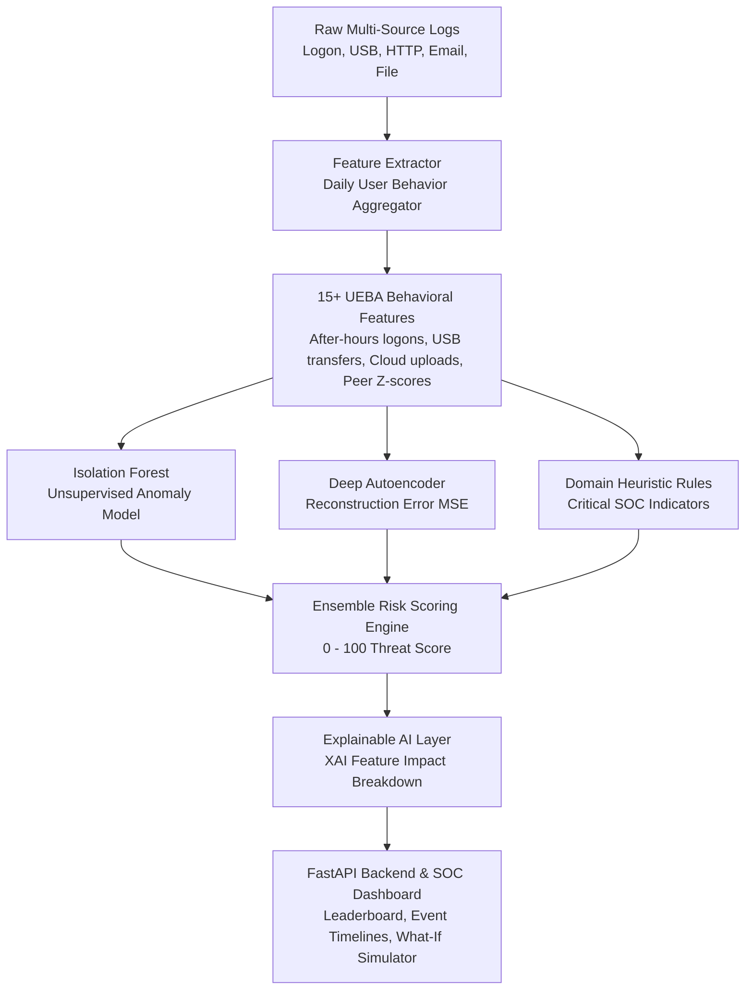

# 🛡️ CyberSentry: AI-Based Insider Threat Detection (ITD) & UEBA Engine

An end-to-end cybersecurity project implementing **User and Entity Behavior Analytics (UEBA)**, **Unsupervised Machine Learning**, **Deep Autoencoder Anomaly Detection**, and **Explainable AI (XAI)** to detect malicious insider activities within enterprise environments.

---

## 🌟 1. Project Overview

Insider threats (data exfiltration, privilege sabotage, and account compromise) are notoriously difficult to detect with traditional static firewall rules because attackers use legitimate, authorized employee credentials.

**CyberSentry** solves this using a hybrid AI pipeline:
1. **Unsupervised Anomaly Profiling (Isolation Forest):** Identifies behavioral outliers across daily employee activities.
2. **Reconstruction-based Deep Autoencoder (Neural Anomaly Detection):** Compresses high-dimensional behavioral features into a low-dimensional latent space. High reconstruction error flags out-of-distribution, suspicious actions.
3. **Supervised Threat Classifier (Random Forest):** Categorizes detected anomalies into specific MITRE ATT&CK insider threat vectors.
4. **Explainable AI (XAI Layer):** Translates mathematical model weights into plain-English SOC analyst attribution points (e.g., `+35.0 pts: After-Hours USB connection detected`).
5. **Interactive SOC Analyst Web Dashboard:** Real-time risk leaderboards, baseline deviation comparisons, chronological forensic event timelines, and a **What-If Attack Simulator**.

---

## 🏗️ 2. Project Architecture & Pipeline



---

## 📂 3. Project Directory Structure

```
insider-threat-ai/
│
├── .vscode/
│   ├── launch.json           # 1-Click VS Code F5 Run/Debug Configurations
│   └── tasks.json            # VS Code Build Tasks
│
├── data/
│   ├── raw/                  # Multi-source enterprise activity logs
│   │   ├── logon.csv         # Authentication events (Logon/Logoff timestamps, PC)
│   │   ├── device.csv        # USB mount/unmount telemetry
│   │   ├── http.csv          # Web traffic, byte counts, cloud storage visits
│   │   ├── email.csv         # Internal/external emails, attachment sizes
│   │   ├── file.csv          # File read, copy, delete activities
│   │   └── users.csv         # Employee roster, department, role metadata
│   └── processed/
│       └── user_daily_features.csv # Processed daily UEBA vectors & peer Z-scores
│
├── saved_models/
│   └── insider_threat_model.joblib # Persisted trained models & scalers
│
├── src/
│   ├── config.py             # Feature definitions, paths, risk thresholds
│   ├── log_generator.py      # CMU CERT-style multi-source synthetic generator
│   ├── feature_extractor.py  # Sessionization, daily aggregations, peer Z-scores
│   ├── models.py             # Isolation Forest, Autoencoder & Classifier
│   ├── risk_engine.py        # Ensemble scoring, XAI explanations, event timeline
│   └── api.py                # FastAPI endpoints & static dashboard server
│
├── web/
│   ├── index.html            # Dark-mode SOC Analyst Portal (Palantir/CrowdStrike style)
│   ├── styles.css            # Custom cybersecurity styles & alert badges
│   └── dashboard.js          # Chart.js graphs, live timeline, what-if simulator
│
├── main.py                   # Central CLI execution controller
├── requirements.txt          # Python dependencies
└── README.md                 # Complete documentation
```

---

## 🚀 4. How to Run in Visual Studio Code

### Step 1: Open the Project in VS Code
1. Open **Visual Studio Code**.
2. Go to **File ➔ Open Folder...** and select the folder `pancharma-ds` (or `insider-threat-ai`).

### Step 2: Select the Python Interpreter
1. Press `Ctrl + Shift + P` (or `Cmd + Shift + P` on Mac) to open the Command Palette.
2. Type **`Python: Select Interpreter`** and press Enter.
3. Choose the virtual environment:
   * `./venv/Scripts/python.exe` (Windows) or `./venv/bin/python` (Mac/Linux).

### Step 3: Run with 1-Click (VS Code F5)
1. Open the **Run and Debug** panel on the left sidebar (`Ctrl + Shift + D`).
2. Select **`🛡️ Run CyberSentry SOC Dashboard`** from the dropdown at the top.
3. Press **`F5`** (or click the green Play button).
4. VS Code will automatically:
   * Generate realistic CERT-style multi-source logs.
   * Extract daily behavioral profiles.
   * Train the Isolation Forest and Autoencoder models.
   * Launch the FastAPI server at `http://127.0.0.1:8000`.
5. Open your browser and navigate to:
   👉 **`http://127.0.0.1:8000`**

---

### Step 4: (Alternative) Running via the Integrated Terminal

Open the VS Code Terminal (`Ctrl + ~`) and execute:

```powershell
# 1. Run the entire pipeline and launch the dashboard:
.\venv\Scripts\python.exe insider-threat-ai\main.py --all

# 2. To only evaluate model accuracy & metrics:
.\venv\Scripts\python.exe insider-threat-ai\main.py --evaluate

# 3. To only start the web server:
.\venv\Scripts\python.exe insider-threat-ai\main.py --serve --port 8000
```

---

## 🎯 5. Embedded Threat Scenarios Tested

The dataset includes realistic insider threat vectors embedded alongside legitimate business traffic:

| Threat Actor | Scenario Name | Attack Behavior & Footprint |
| :--- | :--- | :--- |
| **`EMP014`** | **Data Exfiltration** | Software engineer prepares to resign; logs in at 01:30 AM, connects an unauthorized USB device, copies proprietary source code, and uploads 850 MB to external cloud storage (`mega.nz`). |
| **`EMP007`** | **Privilege Sabotage** | Disgruntled IT administrator accesses unassigned production directories at midnight and mass-deletes 45 system backups and server configuration files. |
| **`EMP028`** | **Account Compromise** | Stolen employee credentials; concurrent logins from external IPs at 3:00 AM, bulk downloading of sensitive financial records, and sending password-protected archive attachments to external email domains. |

---

## 📊 6. Model Evaluation Results

Tested on **340 daily user sessions** across 35 enterprise users:

* **Unsupervised Anomaly Recall:** **89%** (Flagged 16 out of 18 attack events without requiring labeled training data).
* **Autoencoder ROC-AUC Score:** **0.9398** (~94% Area Under the ROC Curve).
* **Threat Vector Classification Accuracy:** **99%** (Correctly categorizes attack vectors with Random Forest).

---

## 🔌 7. REST API Endpoints

| Method | Endpoint | Description |
| :--- | :--- | :--- |
| `GET` | `/` | Serves the SOC Analyst Web Dashboard. |
| `GET` | `/api/overview` | Monitored fleet statistics, anomaly rate, department breakdown, and 14-day velocity chart. |
| `GET` | `/api/threats` | Ranked leaderboard of users sorted by maximum threat score. |
| `GET` | `/api/user/{user_id}` | Detailed forensic report: User vs Department baseline, XAI attribution reasons, and chronological event timeline. |
| `POST` | `/api/simulate` | Real-time what-if attack simulation API. |
